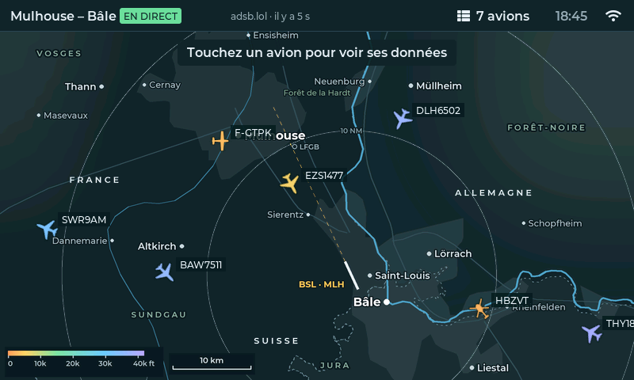
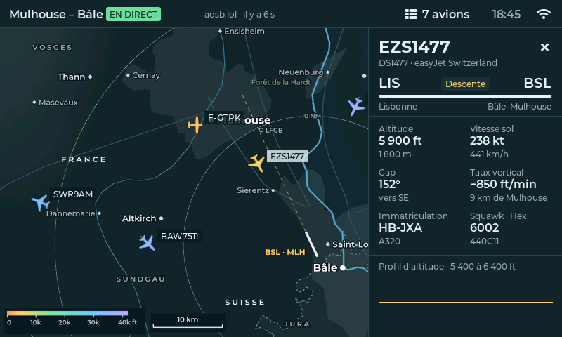
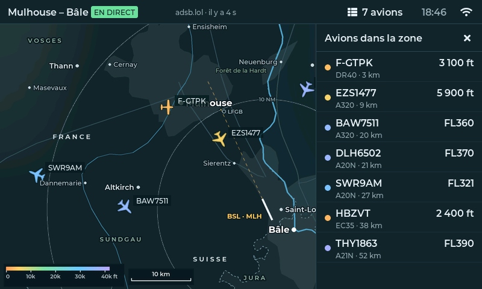
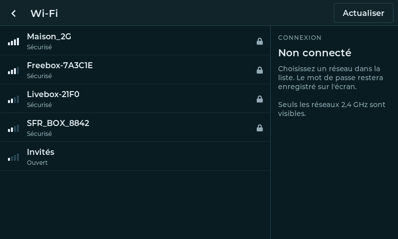

# viz-plane

A 7″ touchscreen that sits on a desk, powered by a single USB-C cable, showing the aircraft flying over Mulhouse and Basel in real time.



- **Map**: the Mulhouse–Basel area (borders, Rhine, motorways, towns, EuroAirport), with aircraft rotated to their heading and coloured by altitude.
- **Flight card**: tap an aircraft to see its route, altitude, ground speed, heading, vertical rate, registration and altitude profile.
- **List**: every aircraft in the area, sorted by distance to Mulhouse.
- **Wi-Fi**: pick a network and type the password on an on-screen AZERTY keyboard; both are remembered.
- **Enclosure**: 3D printed wedge tilted 18°, orange frame and black base.

The on-screen interface is in French.

| Flight card | List | Wi-Fi settings | Password |
|---|---|---|---|
|  |  |  |  |

Screenshots from the Mac simulator, with demo traffic. The firmware has not run on the real screen yet.

## Hardware

| Part | Price |
|---|---|
| [Waveshare ESP32-S3-Touch-LCD-7](https://www.waveshare.com/wiki/ESP32-S3-Touch-LCD-7): 7″, 800×480, capacitive touch | ~€54 |
| Kit of M3 stainless button-head screws (ISO 7380) | ~€7 |
| Black and orange filament, USB-C cable and charger | — |

## Repository layout

| Folder | Contents |
|---|---|
| [`firmware/`](firmware/) | ESP-IDF 5.4 + LVGL 8.4 firmware, and a Mac simulator running the same UI |
| [`enclosure/`](enclosure/) | Parametric OpenSCAD enclosure, STL files, Bambu Studio project, 3D viewer |
| [`radar.py`](radar.py) | First prototype: web simulator of the screen, fed with live aircraft |

## Quick start

Mac simulator (needs SDL2 and CMake):

```sh
cd firmware/sim && cmake -S . -B build -G Ninja && ninja -C build
./build/radar_sim            # live aircraft
./build/radar_sim --demo     # frozen demo traffic
```

Firmware on the screen (needs ESP-IDF 5.4):

```sh
. ~/esp/esp-idf/export.sh
cd firmware && idf.py build && idf.py -p /dev/cu.usbmodem* flash monitor
```

Web prototype:

```sh
python3 radar.py             # then open http://127.0.0.1:8080
```

## Enclosure


Three parts that print without supports: the frame in orange, the shell and the stand in black. The screen screws in from the back into its 4 M3 inserts. Printing and assembly details are in [`enclosure/README.md`](enclosure/README.md).

| Exploded view | Side view |
|---|---|
|  |  |

## Data

ADS-B positions come from the free community networks [adsb.lol](https://adsb.lol), [adsb.fi](https://adsb.fi) and [airplanes.live](https://airplanes.live), falling back from one to the next and backing off automatically when rate limited. Routes are looked up by callsign through [adsbdb](https://www.adsbdb.com). Map data: Natural Earth, france-geojson, swiss-maps (FSO/swisstopo), deutschlandGeoJSON.

## Third-party licences

- LVGL: MIT
- cJSON: MIT
- Hardware layer from the Waveshare example: CC0
- Montserrat fonts: SIL Open Font License
