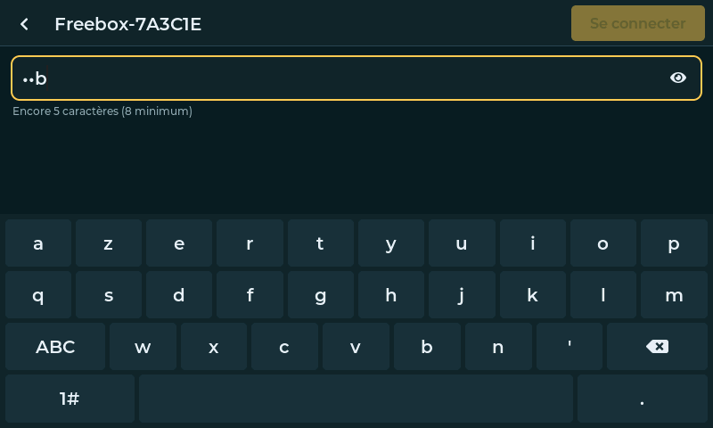
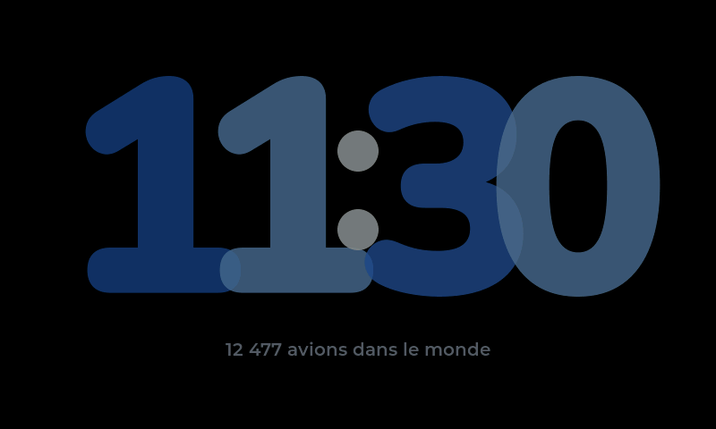
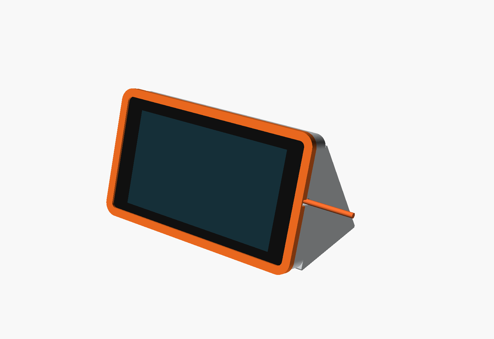
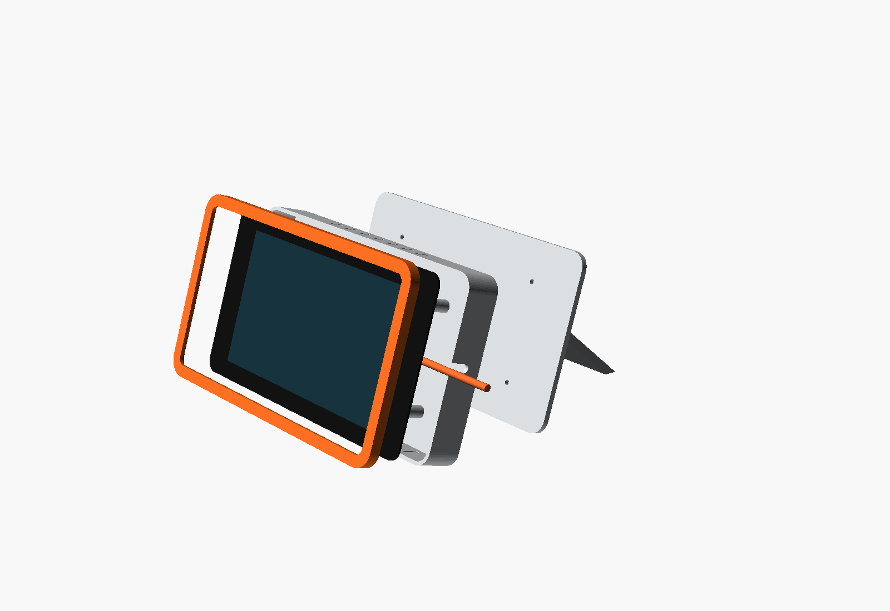
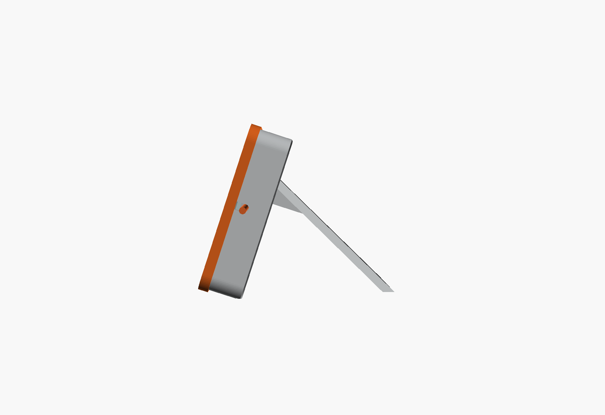

# viz-plane

A 7″ touchscreen that sits on a desk, powered by a single USB-C cable, showing the aircraft flying over Mulhouse and Basel in real time.


- **Map**: the Mulhouse–Basel area (borders, Rhine, motorways, towns, EuroAirport), with aircraft rotated to their heading and coloured by altitude. The top bar shows how many aircraft are tracked worldwide.
- **Flight card**: tap an aircraft to see its route, altitude, ground speed, heading, vertical rate, registration and altitude profile. The selected aircraft gets a ring on the map, the others are dimmed.
- **Routes**: from hexdb.io, checked against the aircraft's position and heading; departures from and arrivals to EuroAirport are read off the flight itself.
- **Rare aircraft**: emergencies (7700, 7600, 7500), military aircraft and giants (A380, 747, An-124, Beluga…) get a coloured tag, and a banner when they enter the area.
- **List**: every aircraft in the area, sorted by distance to Mulhouse.
- **Settings**: pick a Wi-Fi network and type the password on an on-screen AZERTY keyboard; check for updates; sleep mode.
- **Sleep mode**: a big clock on black with the worldwide aircraft count; a tap goes back to the map.
- **Over-the-air updates**: each version tag is built by GitHub Actions and published as a release; screens install it on their own at night.
- **Enclosure**: 3D printed wedge tilted 18°, orange frame and black base.

The on-screen interface is in French.

| Flight card | List | Settings | Password | Sleep mode |
|---|---|---|---|---|
|  |  |  |  |  |

Screenshots from the Mac simulator, with demo traffic (including a military C-17, an A380 and a 7700 emergency). The firmware runs on the real board.

## Hardware

| Part | Price |
|---|---|
| [Waveshare ESP32-S3-Touch-LCD-7](https://www.waveshare.com/wiki/ESP32-S3-Touch-LCD-7): 7″, 800×480, capacitive touch | ~€54 |
| Kit of M3 stainless button-head screws (ISO 7380) | ~€7 |
| Black and orange filament, USB-C cable and charger | — |

## Repository layout

| Folder | Contents |
|---|---|
| [`firmware/`](firmware/) | ESP-IDF 5.4 + LVGL 8.4 firmware, and a Mac simulator running the same UI |
| [`enclosure/`](enclosure/) | Parametric OpenSCAD enclosure, STL files, Bambu Studio project, 3D viewer |
| [`radar.py`](radar.py) | First prototype: web simulator of the screen, fed with live aircraft |

## Quick start

Mac simulator (needs SDL2 and CMake):

```sh
cd firmware/sim && cmake -S . -B build -G Ninja && ninja -C build
./build/radar_sim            # live aircraft
./build/radar_sim --demo     # frozen demo traffic
```

Latest release on a new screen (plugged in on its "USB" port; the first time, hold BOOT while plugging in):

```sh
curl -LO https://github.com/OoscarFrank/viz-plane/releases/latest/download/radar-full.bin
esptool.py --chip esp32s3 write_flash 0x0 radar-full.bin
```

Build and flash from source (needs ESP-IDF 5.4):

```sh
. ~/esp/esp-idf/export.sh
cd firmware && idf.py build && idf.py -p /dev/cu.usbmodem* flash monitor
```

Publish a new version, installed by the screens on their own: `git tag v1.2.0 && git push origin v1.2.0`. Details in [`firmware/README.md`](firmware/README.md).

Web prototype:

```sh
python3 radar.py             # then open http://127.0.0.1:8080
```

## Enclosure



Three parts that print without supports: the frame in orange, the shell and the easel stand in black. Four M3 × 20 screws go through the stand and the shell into the screen's inserts and hold everything together. Printing and assembly details are in [`enclosure/README.md`](enclosure/README.md).

| Exploded view | Side view |
|---|---|
|  |  |

## Data

ADS-B positions come from the free community networks [adsb.lol](https://adsb.lol), [adsb.fi](https://adsb.fi) and [airplanes.live](https://airplanes.live), falling back from one to the next and backing off automatically when rate limited. Routes are looked up by callsign through [hexdb.io](https://hexdb.io), with [adsbdb](https://www.adsbdb.com) for airline names and as a fallback; the worldwide count comes from the [adsb.fi](https://adsb.fi) stats. Map data: Natural Earth, france-geojson, swiss-maps (FSO/swisstopo), deutschlandGeoJSON.

## Third-party licences

- LVGL: MIT
- cJSON: MIT
- Hardware layer from the Waveshare example: CC0
- Montserrat fonts: SIL Open Font License
- Nunito font (screen saver clock): SIL Open Font License
- Airport table: OurAirports (public domain)
